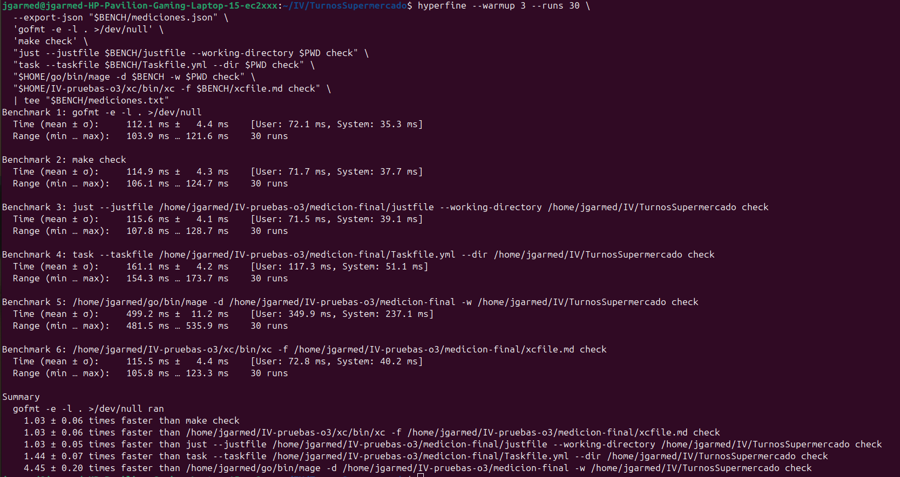
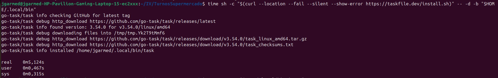
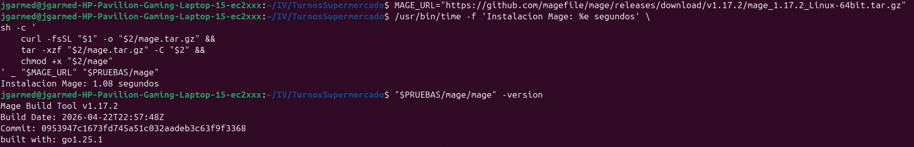

# Automatización de tareas

## Dependencias

El proyecto está hecho en Go y utiliza Go Modules para gestionar las dependencias. Ya tengo `go.mod` y, por ahora, el modelo de turnos no necesita librerías externas. Al ejecutar `go mod download` no hay módulos que descargar.

## Qué necesito automatizar

Después del objetivo 2 tengo seis archivos Go en `internal/turnos`. En el issue #23 planteé automatizar la comprobación de la sintaxis de los archivos Go y la instalación de dependencias.

## Criterios para elegir el gestor

He comparado Make, Just, Task, Mage y XC.

En cuanto a estándares, `make` está definido por POSIX. Just, Task, Mage y XC son gestores distintos y no siguen esa especificación. Go tampoco exige utilizar un gestor de tareas concreto, así que no he descartado ninguna herramienta por este motivo.

Para elegir me he fijado en:

- **Tiempo de ejecución:** cuánto tarda cada herramienta en ejecutar la misma comprobación.
- **Instalación:** si necesito instalar algo aparte para utilizarla.

## Pruebas de ejecución

Hice las pruebas en mi Ubuntu con Go 1.27.4. El archivo `go.mod` indica Go 1.26.8 como versión mínima, pero todas las mediciones las hice con la versión que tengo instalada.

Utilicé Hyperfine con tres ejecuciones de calentamiento y treinta mediciones por comando.

Para comparar las cinco herramientas utilicé `gofmt -e -l .`, que comprueba la sintaxis de los archivos Go sin modificarlos ni compilar el proyecto.

Los resultados fueron:

- Sin gestor: **112,1 ± 4,4 ms**.
- Make: **114,9 ± 4,3 ms**.
- Just: **115,6 ± 4,1 ms**.
- Task: **161,1 ± 4,2 ms**.
- Mage: **499,2 ± 11,2 ms**.
- XC: **115,5 ± 4,4 ms**.

## Instalación de las herramientas

En mi Ubuntu ya tenía Make instalado. Para probar las otras herramientas instalé Just con `apt`, Task con su instalador y Mage con `go install`.

Medí estos tiempos de instalación:

- Task: **5,124 s**.
- Mage: **6,544 s**.

No cronometré la instalación inicial de Just. Tampoco he utilizado los tiempos de Task y Mage para comparar cuál se instala más rápido, porque los instalé de formas distintas.

Además, comprobé las herramientas disponibles en `golang:1.27.4-bookworm`. Esa imagen ya traía Make, mientras que Just, Task y Mage no estaban instalados.

XC lo instalé con `go install` en mi Ubuntu y tardó **6,030 s**.

## Comprobación de la tarea

He añadido dos tareas al `Makefile`:

- `make install`, que ejecuta `go mod download`.
- `make check`, que utiliza `gofmt -e -l .` para comprobar la sintaxis de los archivos Go.

Con los archivos actuales del proyecto, `make check` termina con código de salida `0`.

También he probado un archivo temporal con un error de sintaxis. La tarea detectó el error y terminó con un código distinto de `0`.

Después eliminé el archivo temporal y volví a comprobar que la tarea terminaba correctamente.
