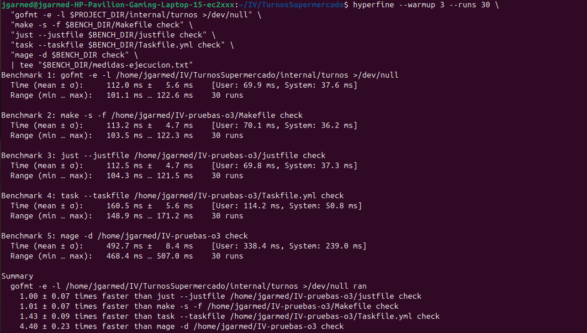
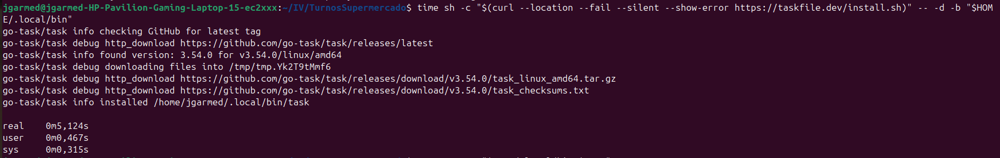
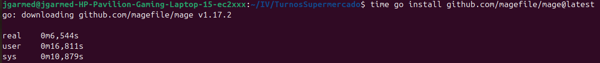
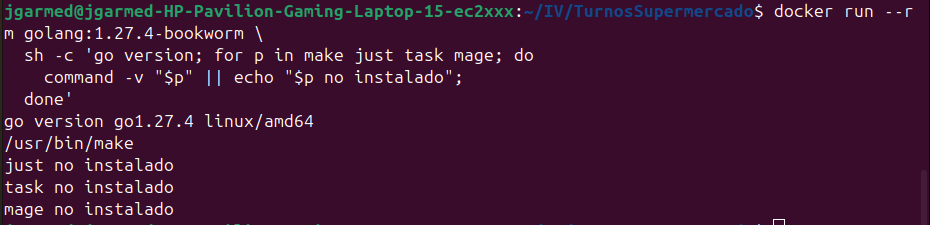

# Automatización de tareas

## Dependencias

El proyecto está hecho en Go y ya tiene `go.mod`. Para gestionar las dependencias voy a utilizar Go Modules, que forma parte del propio lenguaje. Por ahora el modelo de turnos no utiliza librerías externas: `go mod download` no tiene módulos que descargar.

## Qué necesito automatizar

Después del objetivo 2 tengo seis archivos Go en `internal/turnos`. En el issue #23 planteé preparar una tarea para comprobar su sintaxis desde la raíz del proyecto, sin cambiar los archivos ni ejecutar la lógica de los turnos. También necesito una tarea para descargar las dependencias cuando las haya.

## Criterios para elegir el gestor de tareas

Me he fijado en dos cosas:

- **Tiempo de ejecución:** lo que tarda cada gestor en lanzar la misma comprobación de sintaxis sobre los archivos del modelo.
- **Instalación adicional:** si tengo que instalar el gestor aparte de Go cuando preparo el entorno. Para comprobarlo he tenido en cuenta mi Ubuntu y una imagen de Go que he probado.

## Herramientas probadas

He probado Make, Just, Task y Mage. Preparé los archivos de tareas en `~/IV-pruebas-o3`, fuera del repositorio, para no dejar configuraciones que después no voy a utilizar. Los cuatro consiguieron lanzar `gofmt -e -l` sobre los mismos seis archivos del modelo.

## Tiempo de ejecución

He utilizado Hyperfine en mi Ubuntu, con Go 1.27.4, haciendo tres ejecuciones de calentamiento y treinta mediciones por comando. También medí `gofmt` sin gestor para tener una referencia.

- Sin gestor: **112,0 ± 5,6 ms**.
- Make: **113,2 ± 4,7 ms**.
- Just: **112,5 ± 4,7 ms**.
- Task: **160,5 ± 5,6 ms**.
- Mage: **492,7 ± 8,4 ms**.

Make y Just han tardado prácticamente lo mismo que el comando directo. Task ha tardado más y Mage ha sido el más lento en esta prueba. Estos resultados son de mi equipo y de esta tarea concreta.

## Instalación y disponibilidad

En mi Ubuntu Make ya estaba instalado. Tuve que instalar Just con `apt`, Task con su instalador y Mage con `go install`.

De esas instalaciones medí los tiempos de Task (**5,124 s**) y Mage (**6,544 s**).

No medí el tiempo de instalación de Just y Make ya estaba disponible. Además, instalé Task y Mage de formas distintas, así que esos segundos no permiten comparar la instalación de las cuatro herramientas en las mismas condiciones.

También comprobé la imagen `golang:1.27.4-bookworm`: traía Make instalado, pero no Just, Task ni Mage. Esta observación corresponde a esa imagen, no a todos los entornos donde se pueda utilizar Go.

## Elección

Al final me quedo con Make. En las pruebas ha tardado prácticamente lo mismo que Just: 113,2 ms frente a 112,5 ms. La diferencia es muy pequeña, así que por tiempo de ejecución no tengo un motivo claro para preferir uno de los dos.

Lo que me hace elegir Make es que ya estaba instalado en mi Ubuntu y también venía en la imagen de Go que probé. Para utilizar Just tuve que instalarlo aparte. Task y Mage también necesitaron instalación y tardaron más en ejecutar la comprobación.

Para las tareas que necesito ahora no veo necesario añadir otra herramienta. Esto no significa que Make venga instalado siempre, pero en los entornos que he comprobado puedo utilizarlo directamente.
