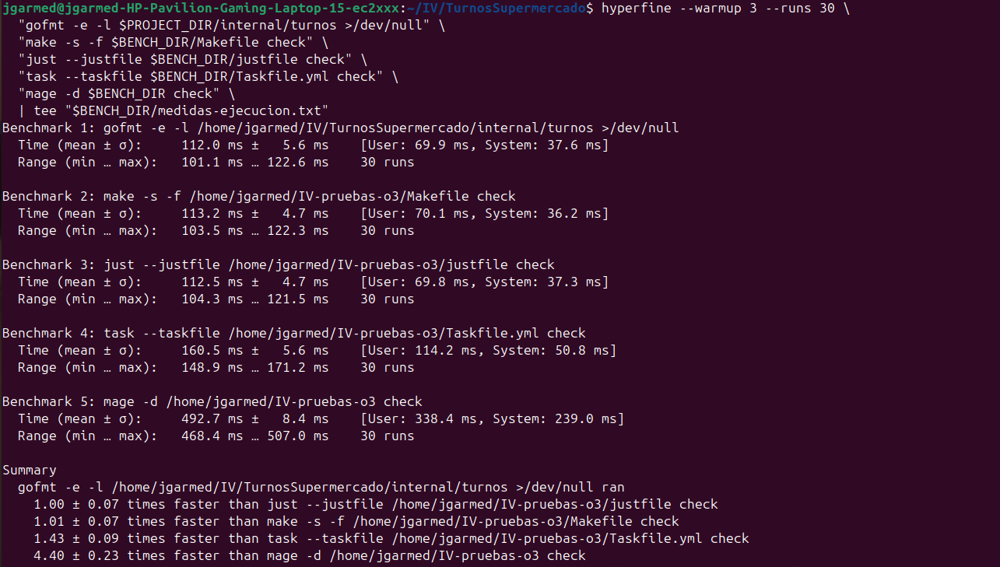
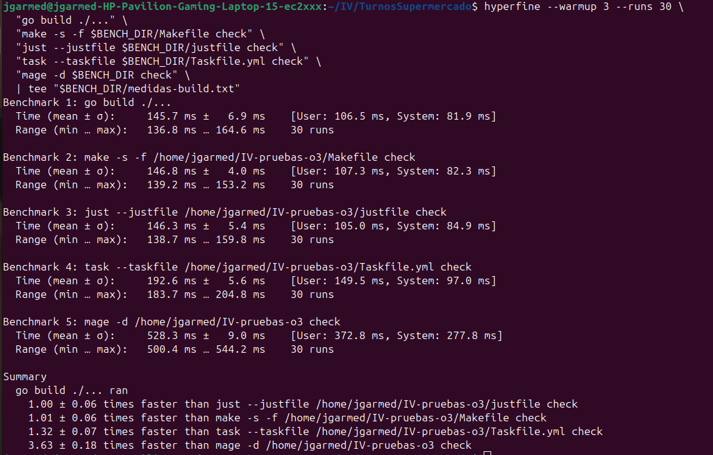
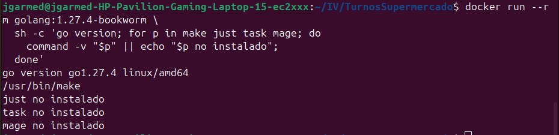
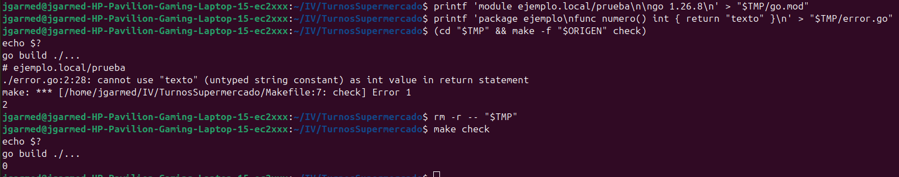

# Automatización de tareas

## Dependencias

El proyecto está hecho en Go y ya tiene `go.mod`. Para gestionar las dependencias voy a utilizar Go Modules, que forma parte del propio lenguaje. Por ahora el modelo de turnos no utiliza librerías externas: `go mod download` no tiene módulos que descargar.

## Qué necesito automatizar

Después del objetivo 2 tengo seis archivos Go en `internal/turnos`. En el issue #23 planteé preparar una tarea para comprobar que los archivos Go del proyecto compilan correctamente, sin ejecutar la lógica de los turnos. También necesito una tarea para descargar las dependencias cuando las haya.

## Criterios para elegir el gestor de tareas

También he revisado el tema de los estándares. `make` es una utilidad definida por POSIX, aunque eso no significa que sea el gestor de tareas de Go. Para las dependencias ya utilizo Go Modules.

Para comparar las alternativas me he fijado en dos cosas:

- **Tiempo de ejecución:** lo que tarda cada gestor en lanzar la misma comprobación sobre los paquetes Go del proyecto.
- **Instalación adicional:** si tengo que instalar el gestor aparte de Go cuando preparo el entorno. Para comprobarlo he tenido en cuenta mi Ubuntu y una imagen de Go que he probado.

## Herramientas probadas

He probado Make, Just, Task y Mage. Primero ejecuté la misma comprobación con `gofmt` en las cuatro herramientas. Después repetí las medidas utilizando `go build ./...`, que es lo que utiliza ahora la tarea `check`.

## Tiempo de ejecución

He utilizado Hyperfine en mi Ubuntu, con Go 1.27.4, haciendo tres ejecuciones de calentamiento y treinta mediciones por comando. También medí `gofmt` sin gestor para tener una referencia.

En `go.mod` aparece Go 1.26.8, que es la versión mínima requerida por el proyecto. Las medidas las hice con Go 1.27.4 porque es la versión que tengo instalada en mi equipo. Utilicé esa misma versión para todas las herramientas, así que la comparación corresponde a ese entorno. No he repetido las mediciones con Go 1.26.8.

- Sin gestor: **112,0 ± 5,6 ms**.
- Make: **113,2 ± 4,7 ms**.
- Just: **112,5 ± 4,7 ms**.
- Task: **160,5 ± 5,6 ms**.
- Mage: **492,7 ± 8,4 ms**.

Make y Just han tardado prácticamente lo mismo que el comando directo. Task ha tardado más y Mage ha sido el más lento en esta prueba. Estos resultados son de mi equipo y de esta tarea concreta.

### Comprobación de compilación

Después de cambiar la tarea `check` para comprobar también los errores de nombres y tipos, he repetido las medidas utilizando `go build ./...`.

He vuelto a usar Hyperfine, con tres ejecuciones de calentamiento y treinta mediciones por comando. Todas las herramientas han ejecutado la misma comprobación sobre los paquetes del proyecto.

Los resultados han sido:

- Sin gestor: **145,7 ± 6,9 ms**.
- Make: **146,8 ± 4,0 ms**.
- Just: **146,3 ± 5,4 ms**.
- Task: **192,6 ± 5,6 ms**.
- Mage: **528,3 ± 9,0 ms**.

## Instalación y disponibilidad

En mi Ubuntu Make ya estaba instalado. Tuve que instalar Just con `apt`, Task con su instalador y Mage con `go install`.

De esas instalaciones medí los tiempos de Task (**5,124 s**) y Mage (**6,544 s**).

No medí cuánto tardó Just en instalarse y Make ya estaba instalado. Por eso, para elegir entre Make y Just me fijé en si necesitaba instalar otra herramienta, no en los segundos que tardaba la instalación. Los tiempos de Task y Mage los dejo como resultados de esas pruebas, pero no sirven para comparar directamente las cuatro instalaciones porque se hicieron de formas distintas.

También comprobé la imagen `golang:1.27.4-bookworm`: traía Make instalado, pero no Just, Task ni Mage. Esta observación corresponde a esa imagen, no a todos los entornos donde se pueda utilizar Go.

## Elección

Después de repetir las pruebas con `go build ./...`, sigo eligiendo Make.

En la nueva comparación, Make ha tardado 146,8 ms y Just 146,3 ms. La diferencia de 0,5 ms es muy pequeña y no me parece suficiente para elegir uno por encima del otro. Task ha tardado 192,6 ms y Mage 528,3 ms.

Me quedo con Make porque ya estaba instalado en mi Ubuntu y también venía en la imagen de Go que comprobé. Además, es una herramienta definida por POSIX. Para utilizar Just tuve que instalarlo aparte.

Make no tiene por qué venir instalado en todos los entornos, pero para los que he comprobado no necesito añadir otra herramienta. Con estos resultados, mantengo la elección inicial.

## Comprobación de la tarea

He ejecutado `make check` desde la raíz del proyecto y ha terminado con código de salida 0.

También he probado la tarea con un archivo Go que devuelve un `string` cuando la función debería devolver un `int`. Hice la prueba en una carpeta temporal para no modificar el modelo. En ese caso `make check` ha detectado el error de tipos y ha terminado con código distinto de 0.

La tarea utiliza `go build ./...` para comprobar que los paquetes compilan. No ejecuta los tests ni utiliza `go vet`.

