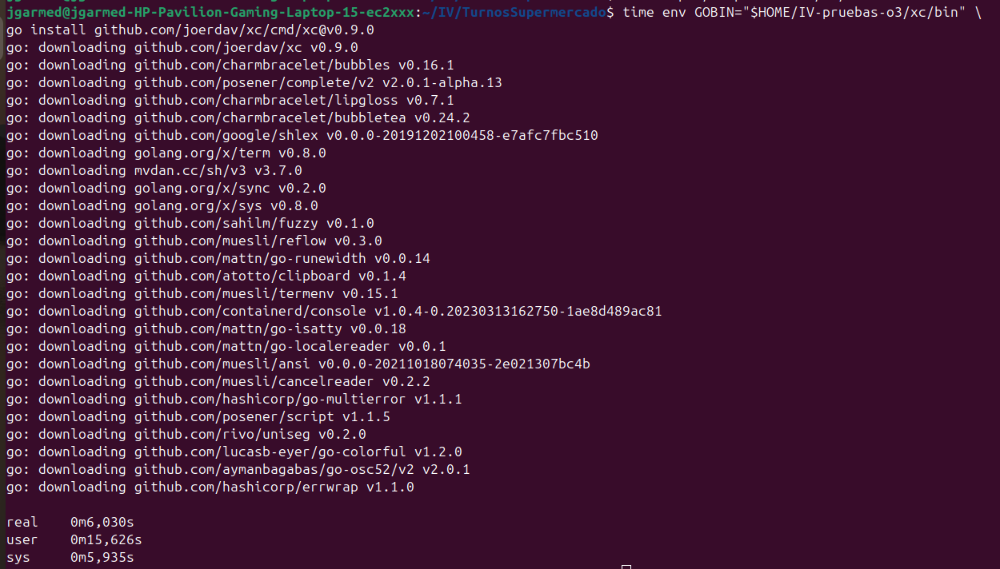
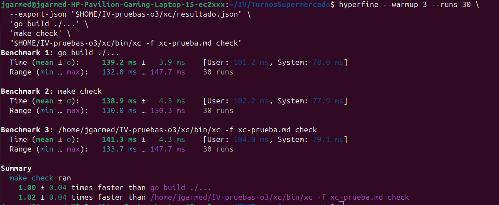

# Automatización de tareas

## Dependencias

El proyecto está hecho en Go y utiliza Go Modules para gestionar las dependencias. Ya tengo `go.mod` y, por ahora, el modelo de turnos no necesita librerías externas. Al ejecutar `go mod download` no hay módulos que descargar.

## Qué necesito automatizar

Después del objetivo 2 tengo seis archivos Go en `internal/turnos`. En el issue #23 planteé automatizar la comprobación de sintaxis y la instalación de dependencias.

Al principio utilicé `gofmt`, pero después cambié la tarea para comprobar que los paquetes Go compilan, incluidos los errores de nombres y tipos.

## Criterios para elegir el gestor

He comparado Make, Just, Task, Mage y XC teniendo en cuenta tres aspectos:

- **Estándares:** `make` está definido por POSIX, así que lo he tenido en cuenta al estudiar las alternativas.
- **Tiempo de ejecución:** cuánto tarda cada herramienta en ejecutar la misma comprobación.
- **Instalación:** si necesito instalar algo aparte para utilizarla.

## Pruebas de ejecución

Hice las pruebas en mi Ubuntu con Go 1.27.4. El archivo `go.mod` indica Go 1.26.8 como versión mínima, pero todas las mediciones las hice con la versión que tengo instalada.

Utilicé Hyperfine con tres ejecuciones de calentamiento y treinta mediciones por comando.

### Primera prueba: sintaxis

Empecé con `gofmt -e -l` para comprobar la sintaxis del modelo. Lo ejecuté con los cuatro gestores y también directamente para tener una referencia.

Los resultados fueron:

- Sin gestor: **112,0 ± 5,6 ms**.
- Make: **113,2 ± 4,7 ms**.
- Just: **112,5 ± 4,7 ms**.
- Task: **160,5 ± 5,6 ms**.
- Mage: **492,7 ± 8,4 ms**.

Make y Just apenas añaden tiempo al comando directo. Task tarda unos 49 ms más y Mage unos 381 ms más.

### Segunda prueba: compilación

Después repetí las pruebas con `go build ./...`. Con este comando también se detectan errores como utilizar una variable que no existe o devolver un tipo incorrecto.

Mantuve las mismas condiciones de Hyperfine y obtuve estos resultados:

- Sin gestor: **145,7 ± 6,9 ms**.
- Make: **146,8 ± 4,0 ms**.
- Just: **146,3 ± 5,4 ms**.
- Task: **192,6 ± 5,6 ms**.
- Mage: **528,3 ± 9,0 ms**.

Make y Just siguen tardando casi lo mismo. Task y Mage necesitan más tiempo para ejecutar la comprobación.

## Instalación de las herramientas

En mi Ubuntu ya tenía Make instalado. Para probar las otras herramientas instalé Just con `apt`, Task con su instalador y Mage con `go install`.

En las pruebas iniciales medí estas instalaciones:

- Task: **5,124 s**.
- Mage: **6,544 s**.

No cronometré la instalación inicial de Just en mi portátil. Tampoco he utilizado los tiempos de Task y Mage para comparar cuál se instala más rápido, porque los instalé de formas distintas.

Además, comprobé las herramientas disponibles en `golang:1.27.4-bookworm`. Esa imagen ya traía Make, mientras que Just, Task y Mage no estaban instalados.

## Prueba de XC

También he probado XC v0.9.0, que permite definir tareas en un archivo Markdown.

Lo instalé con `go install` en mi Ubuntu. La instalación tardó **6,030 s**.

Para probarlo definí una tarea `check` que ejecuta `go build ./...`, igual que las otras herramientas.

Repetí la comparación con Hyperfine, utilizando tres ejecuciones de calentamiento y treinta mediciones por comando.

Los resultados fueron:

- Sin gestor: **139,2 ± 3,9 ms**.
- Make: **138,9 ± 4,3 ms**.
- XC: **141,3 ± 4,3 ms**.

## Elección

Me quedo con Make.

Con `go build ./...`, Make ha tardado **146,8 ms** y Just **146,3 ms**. La diferencia es de solo **0,5 ms**, mientras que las desviaciones medidas son de 4,0 y 5,4 ms. Con estos resultados no veo una ventaja clara de Just en tiempo de ejecución.

Make está definido por POSIX y ya estaba instalado tanto en mi Ubuntu como en la imagen de Go que comprobé. Just necesitaba una instalación adicional en esos entornos.

Para las tareas que necesito ahora, Make me sirve sin tener que añadir otra herramienta.

También probé XC con `go build ./...`. En esta prueba, Make tardó **138,9 ± 4,3 ms** y XC **141,3 ± 4,3 ms**. La diferencia es pequeña y no veo una ventaja clara de uno sobre otro en el tiempo de ejecución.

XC tardó **6,030 s** en instalarse, mientras que Make ya estaba instalado en mi equipo. Por eso sigo eligiendo Make.

## Comprobación de la tarea

He añadido dos tareas al `Makefile`:

- `make install`, que ejecuta `go mod download`.
- `make check`, que ejecuta `go build ./...`.

Con los archivos actuales del proyecto, `make check` termina con código de salida `0`.

También preparé un archivo temporal con una función que debía devolver un `int`, pero devolvía un `string`. Al ejecutar `make check`, detectó el error de tipos y terminó con un código distinto de `0`.

La prueba se hizo fuera del modelo de turnos. `check` comprueba la compilación de los paquetes, sin ejecutar tests ni `go vet`.

