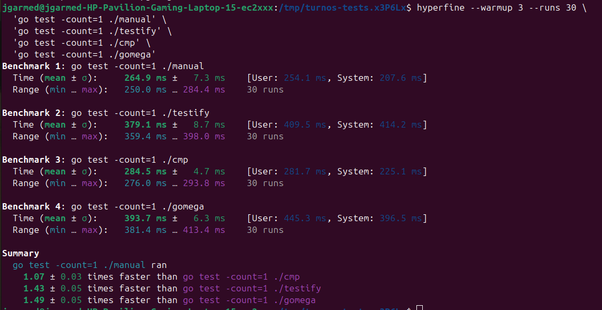
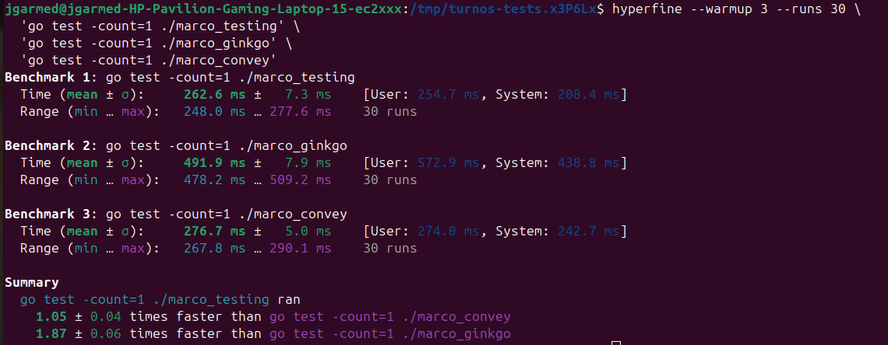
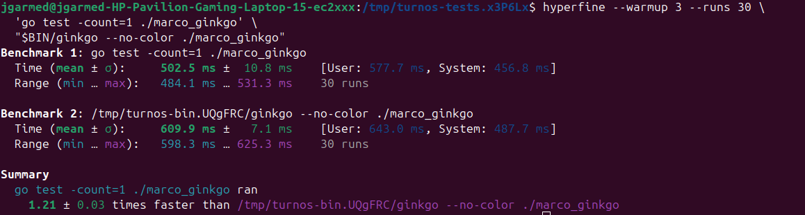
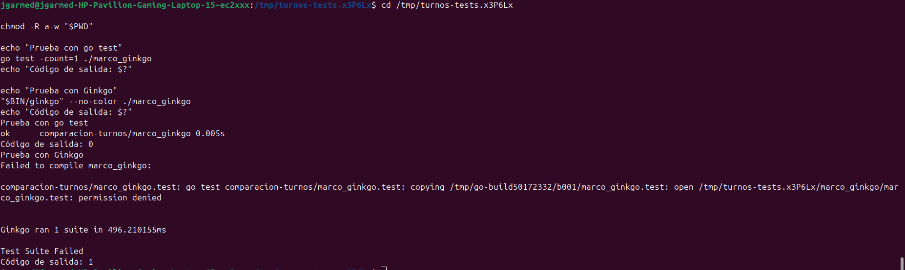
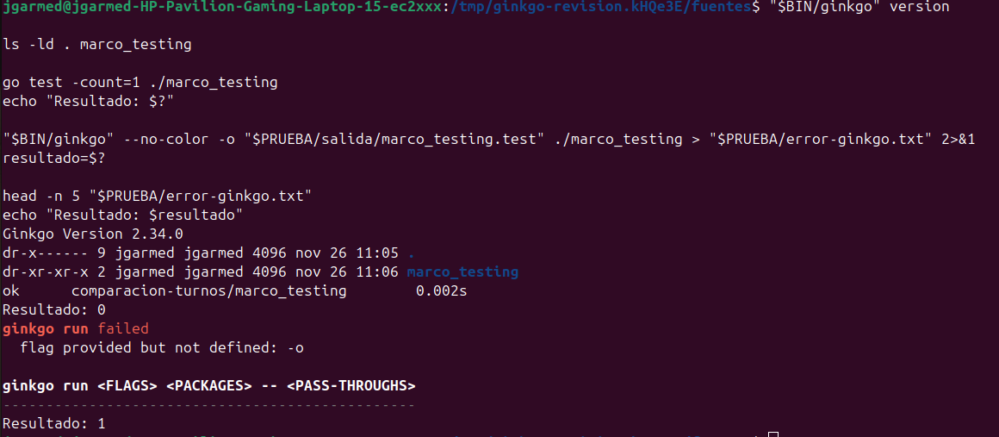
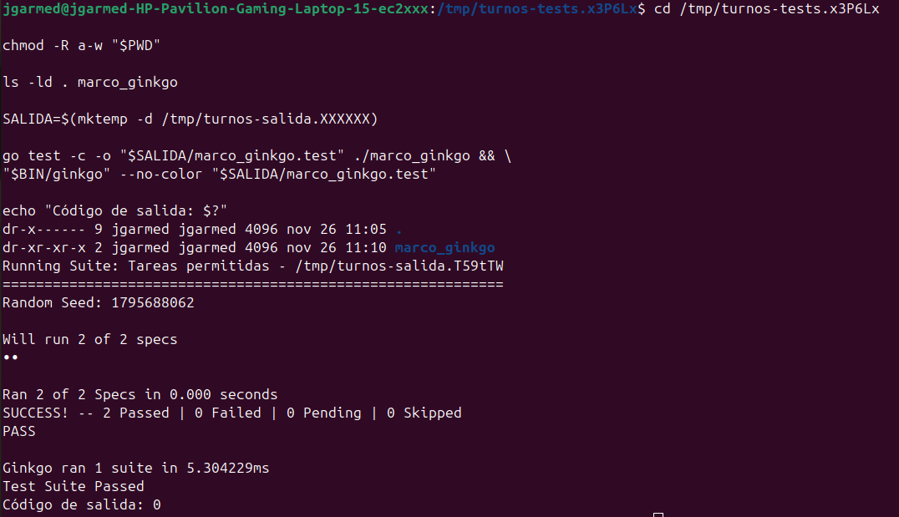
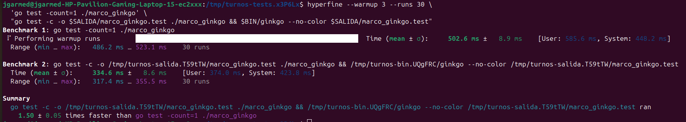

# Herramientas para los tests

Necesito comprobar que Juan puede repartir las tareas entre los trabajadores teniendo en cuenta sus horarios, las tareas que pueden hacer y las que ya tienen asignadas.

He buscado alternativas en la [documentación de Go](https://pkg.go.dev/testing) y en el apartado de testing de [Awesome Go](https://github.com/avelino/awesome-go#testing).

Para hacer las pruebas he usado una copia del código en un directorio temporal. Así no añado al proyecto las dependencias de todas las herramientas que estoy comparando.

Las medidas se han hecho en Linux con Go 1.27.4 y Hyperfine 1.18.0, con tres ejecuciones de calentamiento y treinta mediciones. He usado `go test -count=1` para que se ejecuten los tests cada vez.

## Biblioteca de aserciones

### Criterios

- Cómo se comprueba el resultado y el error de una asignación.
- Tiempo de ejecución del mismo test con cada opción.

### Opciones

Para comparar las alternativas he comprobado que un trabajador puede atender caja y que no se le puede asignar la recogida de palés si no tiene esa tarea permitida.

- Sin biblioteca de aserciones: compruebo el resultado con un `if` y el error con `errors.Is(err, ErrTareaNoPermitida)`. Si no coinciden con lo esperado, marco el fallo con `t.Errorf` o `t.Error`. Tarda 264,9 ± 7,3 ms.
- [Testify](https://github.com/stretchr/testify) (1.12.1): las comprobaciones se hacen con `assert.True(t, permitido)` y `assert.ErrorIs(t, err, ErrTareaNoPermitida)`. Tarda 379,1 ± 8,7 ms.
- [go-cmp](https://github.com/google/go-cmp) (0.7.0): uso `cmp.Diff` para comparar los resultados. Sigo necesitando `errors.Is` para comprobar el error y `t.Error` para indicar el fallo. Tarda 284,5 ± 4,7 ms.
- [Gomega](https://github.com/onsi/gomega) (1.44.0): usa matchers. Para este test he usado `BeTrue()` y `MatchError(ErrTareaNoPermitida)`. Tarda 393,7 ± 6,3 ms.

### Elección

No voy a usar una biblioteca de aserciones. Las comprobaciones que necesito hacer son sencillas y puedo comparar los errores con `errors.Is`. Además, es la opción que menos tarda de las cuatro que he probado.

## Framework de tests

### Criterios

- Cómo se agrupan varios casos de un mismo test y se identifica cuál falla.
- Tiempo de ejecución de los mismos casos.

### Opciones

He probado dos casos de las tareas permitidas de un trabajador: puede atender caja y no puede recoger palés. He mantenido la misma comprobación en los tres frameworks.

- [testing](https://pkg.go.dev/testing): recorro los casos con un `for` y uso `t.Run` con el nombre de cada tarea. Tarda 262,6 ± 7,3 ms.
- [Ginkgo](https://github.com/onsi/ginkgo) (2.34.0): agrupo las pruebas con `Describe` y escribo cada caso dentro de `It`. También necesito arrancar la suite con `RunSpecs`. Tarda 491,9 ± 7,9 ms.
- [GoConvey](https://github.com/smartystreets/goconvey) (1.8.1): usa bloques `Convey` que se pueden agrupar unos dentro de otros. Tarda 276,7 ± 5,0 ms.

### Elección

Me quedo con `testing`. Los tiempos de GoConvey y testing son bastante cercanos. Para probar distintos trabajadores y horarios me basta con recorrer los casos con un `for` y distinguirlos con `t.Run`.

Ginkgo necesita más código para organizar estos mismos casos y tarda casi el doble que `testing`.

## Herramienta CLI para ejecutar los tests

### Criterios

- Que termine después de ejecutar los tests.
- Que funcione con los fuentes en solo lectura.
- Tiempo que tarda en ejecutar los mismos tests.

### Opciones

- [go test](https://pkg.go.dev/cmd/go): busca, compila y ejecuta los tests de los paquetes.
- [Ginkgo CLI](https://onsi.github.io/ginkgo/) (2.34.0).
- [GoConvey CLI](https://github.com/smartystreets/goconvey): inicia un servidor para consultar los resultados desde el navegador. No lo he medido porque necesito que la tarea `test` termine por sí sola.

También he considerado gotestsum, que usa `go test` y cambia la forma de mostrar los resultados.

### Pruebas

Primero he ejecutado los dos casos escritos con Ginkgo usando las dos órdenes:

- `go test -count=1`: 502,5 ± 10,8 ms.
- Ginkgo CLI: 609,9 ± 7,1 ms.

Después he quitado los permisos de escritura del directorio temporal con `chmod -R a-w`.

Con `go test` pasan los tests. Ginkgo falla porque intenta guardar el fichero `marco_ginkgo.test` dentro del directorio del paquete.

También he probado a ejecutar los tests escritos con `testing` indicando otro directorio para el binario mediante `-o`. Ginkgo no reconoce esta opción al ejecutar los tests, mientras que con `go test` pasan sin necesidad de cambiar ningún permiso.

He probado a compilar el binario con `go test -c -o` indicando un directorio fuera de los fuentes. Al ejecutar ese binario con Ginkgo pasan los dos casos.

He vuelto a medir los tiempos incluyendo la compilación del binario en cada ejecución:

- `go test`: 502,6 ± 8,9 ms.
- Compilación externa y ejecución con Ginkgo: 334,6 ± 8,6 ms.

Con el binario fuera de los fuentes, Ginkgo tarda menos. He intentado hacer lo mismo con el binario de los tests escritos únicamente con `testing`, pero falla porque no reconoce la opción `-ginkgo.seed`.

### Elección

Voy a usar `go test ./...` desde Make. Funciona con los fuentes en solo lectura sin tener que configurar otro directorio. Ginkgo ha sido más rápido al ejecutar su propio binario con la compilación externa, pero esa misma forma de ejecución no ha funcionado con los tests escritos únicamente con `testing`.

## F.I.R.S.T.

- Fast: una de las ejecuciones de los tests del proyecto ha tardado 0,003 s según la salida de `go test`. Hyperfine mide la orden completa, incluyendo el trabajo de compilación, enlace y arranque del proceso.
- Independent: cada caso de `TestAsignar` prepara sus propios huecos antes de hacer la asignación. He ejecutado los tests diez veces con `go test -shuffle=on -count=10 ./...` y han pasado todas.
- Repeatable: uso fechas fijas, como el 24 de noviembre de 2026, en lugar de obtener la fecha del sistema.
- Self-validating: compruebo los resultados y los errores esperados. Por ejemplo, en `TestAsignar` también compruebo que una asignación rechazada no modifica el reparto.
- Timely: los tests de los issues #25, #27, #28 y #29 se han escrito antes de implementar sus respectivas comprobaciones, como se puede ver en los commits.
